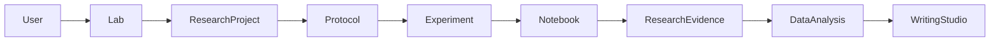

# DRM Modernization Master Plan

Date: 4 October 2026.  
Repository: Digital Research Manager.  
Status: planning only. No application code, schema, or deployment change is authorized by this document.

Companion documents:

- `DRM_DATABASE_CONSOLIDATION_PLAN.md`
- `DRM_SECURITY_MODERNIZATION_PLAN.md`
- `DRM_INCREMENTAL_IMPLEMENTATION_ROADMAP.md`

Inventory source: `DRM_CURRENT_SYSTEM_AUDIT.md`, checked against the repository on the same date. Where this plan and the audit disagree with a file, the file wins and the disagreement is listed in section 14.

Working rule: if a defect can be fixed safely in place, fix or refactor it. A replacement needs a migration and a rollback. A broad rewrite because the current code is imperfect is out of scope.

Stack that stays:

- Frontend: React 18, React Router 6, Vite 6, Tailwind, axios.
- API: Node.js, Express 4, `mysql2`.
- Database: MySQL. Official path is `pnpm db:migrate` over `database/migrations/mysql_*.sql`.
- Scientific computation: Python FastAPI in `stats_service/advanced_main.py`, proxied at `/api/advanced-stats/*`.

Do not migrate to PHP, Laravel, Next.js, PostgreSQL, MongoDB, or Neo4j unless the product owner approves a later stack change.

Preferred order: **fix, then refactor, then replace, then rebuild.**

---

## 1. Executive technical assessment

DRM is a working research-lab product, not a prototype that should be replaced. The running surfaces already cover a lab operating system: personal notebook, protocol library, research evidence, Writing Studio, lab workspace, grants, networking, data bank, marketplace, and Lab Floors. Ask AI is already the global copilot. Scholarly search already uses OpenAlex, Crossref, PubMed, Europe PMC, and Unpaywall.

The risk is the foundation under those surfaces.

- `server/index.ts` is the application and the controller layer. About 126 inline route declarations live there, including auth, labs, protocols, notebook, inventory, instruments, messaging, and the stats proxy. Feature routers in `server/routes/` are mounted near the bottom of that file. Seven route files are not mounted.
- A fresh MySQL database created only by the official migrations does not satisfy every mounted handler. Handlers query tables that no migration creates. One live service still runs `CREATE TABLE` at runtime.
- Identity defaults disagree with the auth middleware. `users.role` defaults to `Research Assistant` and `users.status` defaults to `Offline` in `database/migrations/mysql_migration.sql`. Signup writes `student` or `researcher` and `active`. Middleware rejects a non-`active` status.
- Authorization is authentication plus copied membership queries. `components/ProtectedRoute.tsx` only checks that a user and token exist. `App.tsx` never passes a required role. `utils/roleAccess.ts` is stale and treats `co_supervisor` as level 0.
- The research lifecycle is partly linked and not yet one authorized journey. `database/migrations/mysql_workflow_links.sql` adds nullable `protocol_id`, `experiment_id`, and `notebook_entry_id` columns. Those columns have no foreign keys, and the UI does not walk Project to Protocol to Experiment to Notebook to Evidence to Analysis to Writing Studio as one flow.
- Duplicate models exist for projects, notebooks, bookings, protocols, results, citations, and notifications. Several legacy copies are already unmounted or redirect-only. They should be migrated, then retired, not rewritten.

The first product milestone reuses the modules that already work:

**Existing user, lab, research project, protocol, experiment, notebook observation, research evidence, data analysis, Writing Studio.**

That milestone adds the missing relationships, server-side authorization, and navigation. It does not recreate those modules.

P3 work (new research APIs, a graph database, Research Radar) does not start while P0 and P1 items in section 5 are open.

---

## 2. Current and target architecture

### Current

```text
Browser (React SPA, App.tsx router)
  localStorage JWT (authToken, token)
  pages/*.tsx and large top-level components
        |
        v
Express (server/index.ts + mounted server/routes/*.ts)
  authenticateToken, requireRole, helmet, rate limits
  SQL strings in handlers
  services for AI, scholarly APIs, grants, writing, compliance
        |
        +--> MySQL (mysql2 pool, $1 placeholders rewritten)
        +--> FastAPI stats service (optional for the main SPA)
        +--> OpenAlex, Crossref, PubMed, Europe PMC, Unpaywall, Horizon SEDIA
```

There is no controller, repository, or policy layer. `server/database/setup.ts` and `data/researchlab.db` are a leftover SQLite bootstrap. `pnpm db:reset` runs `psql` and is not a MySQL reset. `docker-compose.yml` still describes a SQLite-style path. Production assumption in the audit is DirectAdmin: PM2, same-origin `/api`, MySQL on the host, Express serving `dist/client` when `SERVE_FRONTEND=true`.

`directadmin-package/database/migrations/` copies the SQL files. A migration edited in only one tree will split production from the repo. New SQL belongs in `database/migrations/`. The package is regenerated with `pnpm pack:directadmin`.

### Target

Same processes. Clearer boundaries inside them.

```text
server/
  routes/          HTTP mapping only
  controllers/     request orchestration
  services/        business rules
  repositories/    SQL
  middleware/      auth, rate limit, errors, request id
  policies/        account role, lab role, resource permission
  validators/      Zod or equivalent, server-side
  integrations/    scholarly, grants, email, object storage, stats
  jobs/            email, embeddings, PDF, ingest, long AI work
  domain/          lifecycle types shared by services
  utils/
```

Routes route. Controllers orchestrate HTTP. Services hold business logic. Policies authorize. Validators validate. Integrations isolate providers. Extraction happens one domain at a time, starting with auth and the research-lifecycle handlers. `server/index.ts` stays the composition root until those slices are moved.

Frontend stays React, Vite, and Tailwind. No new UI library. Over time, screens group by domain (`notebook`, `protocols`, `workspace`, `writing`, `library`, `intelligence`) and share one API client, form errors, loading states, permission checks, and pagination. Hidden routes stay inside parent workflows. Projects, experiments, PI review, and data analysis are not new top-level sidebar items.

Database stays MySQL. Knowledge-graph relationships are relational tables. Neo4j is not introduced.



### Product map

These are product domains, not a new route tree.

| Domain | Product | Canonical home today |
|---|---|---|
| Understand | Research Intelligence | Scholarly library, grants, current trends (later) |
| Operate | Lab Workspace | `/lab-workspace` |
| Record | Scientific record | `/lab-notebook`, `/protocols`, `/data-results`, `/negative-results` |
| Analyze and create | Research creation | Evidence stats, `/data-analysis` (hidden), `/writing-studio` |
| Connect | Research ecosystem | Grants, networking, data bank, marketplace, events, community |
| Learn | Lab Floors | `/lab-floors` (progress in localStorage) |

Cross-cutting: Ask AI, search, profile, notifications, settings, privacy, AI keys and quota.

---

## 3. KEEP / IMPROVE / MERGE / REDESIGN / RETIRE

### KEEP

Healthy working implementations. Improve around them. Do not replace them to make the lifecycle journey exist.

| System | Why it stays |
|---|---|
| Protocol library | Live UI at `/protocols`. Tables `protocols`, `protocol_steps`, `protocol_attachments`, `protocol_sharing`, `protocol_executions`. |
| Scholarly library | `papers`, `paper_identifiers`, `user_library_items`, `reference_collections`, `reference_collection_items`, `paper_chunks`, `scholarly_cache`, `scholarly_audit_events`. Served by `/api/research/*`. |
| Writing Studio | `writing_documents` JSON content, collaborators, invitations, section locks, presence. Immersive editor routes. |
| Lab workspace task tree | `lab_workspaces`, spaces, folders, lists, `workspace_tasks`, subtasks, comments. One workspace per lab. |
| Ask AI chat | `POST /api/ai-research-agent/chat` is the supported copilot entry, including SSE when `stream: true`. |
| Horizon grant ingest | `server/services/grants/horizonEuropeService.ts` uses the SEDIA API. |
| AI key and quota model | `ai_provider_keys` encrypted with AES-256-GCM, `ai_provider_configs`, `ai_platform_usage`, daily platform cap. |
| GDPR route surface | `server/routes/compliance.ts`. Validate behaviour. Do not replace the product concept. |
| FastAPI stats service | Deterministic scientific engine. The UI does not call it yet. The service stays. |

### IMPROVE

Right concept, unsafe or incomplete implementation.

| System | Improvement |
|---|---|
| Registration, login, logout, JWT | Verification, reset, revocation, storage. See the security plan. |
| Lab and resource authorization | One policy helper used by lifecycle handlers. |
| Migrations and column defaults | Fresh migrate must match mounted SQL. Status and role defaults must match middleware. |
| Uploads | Storage abstraction, MIME and size checks, randomized keys, metadata in MySQL. |
| Inventory | Stock movement history beside current quantity. |
| Email | A real port. Dev may log. Production must not claim a send that was only logged. |
| API errors and validation | Consistent status codes and server-side validation on new and touched routes. |
| Tests | The lifecycle journey and IDOR cases are largely untested. |

### MERGE

Duplicate implementations that become one canonical system after a row check and a compatibility window.

| From | To |
|---|---|
| Legacy `projects` | `research_projects`, surfaced inside Lab Workspace |
| `notebook_entries` and `content_blocks` | `lab_notebook_entries` after a production row check |
| `bookings` | Lab-scoped `instrument_bookings`, unless the product owner rejects the merge |
| `results` | `research_data`, if live rows still exist |
| `professional_protocols` | `protocols` (router unmounted; `/professional-protocols` already redirects) |
| `progress_notifications` and `grant_notifications` | One typed `notifications` inbox, after payloads are understood |
| Browser stats on the evidence page and the hidden data-analysis page | One analysis experience whose numerical work runs in FastAPI |
| Conference news, if it stays | `research_events`, after the product owner picks the events source of truth |

Manuscript `writing_citations` stay. They link to `papers` when a scholarly identity exists. They do not become a second copy of the full scholarly record.

### REDESIGN

Keep the product concept. Replace the incomplete shell in place, with the old data still readable.

| Concept | Direction |
|---|---|
| PI review | A workflow on `research_projects` inside Lab Workspace. `/pi-review-dashboard` list loaders are commented out and are not a second product. |
| Current Trends | Later Research Intelligence / Research Radar. P3. The page stays until that exists. |
| Ask AI retrieval | Permission-aware context. The chat route stays the entry. Specialized agents become tools behind Ask AI or Writing Studio. |
| Research projects UI | `research_projects` is canonical. The hidden `/project-management` page is a compatibility shell, not the long-term home. |

### RETIRE

Only after dependencies are gone and a production row count shows the table or route is unused. Nothing in this list is deleted by this planning stage.

| Item | Condition |
|---|---|
| `server/database/setup.ts`, `data/researchlab.db` | No running path imports the SQLite bootstrap |
| `server/working-server.js` | Not the `package.json` start path |
| `pnpm db:reset` (`psql`) | Replaced by a documented MySQL backup restore, not a casual drop |
| Unmounted routers: `paperLibrary.ts`, `professionalProtocols.ts`, `simpleReferences.ts`, `peercred.ts`, `externalDatabases.ts`, `unifiedCollaboration.ts`, `crossEntityIntegration.ts` | No mounted import, and PeerCred / old marketplace rows are either migrated or confirmed empty |
| Unrouted pages in audit section 19 | No remaining import except redirects |
| `presentation-ai-reference/` | Nested app, not imported by `App.tsx` |
| `services/geminiService.ts` | Live AI calls go through the backend. Vite already strips `GEMINI_API_KEY` from the bundle |
| `components/CollaborationService.tsx` WebSocket to `localhost:5002` | No matching WebSocket server in `server/index.ts` |
| Duplicate handlers in `server/index.ts` | `GET /api/health`, `GET /api/lab-notebooks`, and `GET /api/instruments/:id/bookings` are declared twice. Remove the dead copy when that region is touched |

`server/enhancedAIGenerationService.js` (Together API) is legacy. Retire it when no mounted route still imports it.

---

## 4. Priority register

### P0 — Critical

Security failures, unauthorized data access, likely data loss, broken migrations, exposed secrets, or a fresh install that cannot run mounted handlers.

1. Mounted handlers query tables migrations never create: `calendar_events`, `instrument_maintenance`, `resource_exchange_requests`, `resource_exchange_offers`, `data_templates`, `experiment_risks`, `experiment_comments`, `saved_negative_results`, `successful_alternatives`, `failure_patterns`, `negative_results_contributor_stats`, `user_ai_failure_patterns`. Call sites include `server/index.ts`, `server/routes/experimentTracker.ts`, `server/routes/negativeResults.ts`, `server/routes/dashboard.ts`, and `server/services/ContinuousLearningEngine.ts`. The negative-results migration creates `negative_result_saves`, not `saved_negative_results`.
2. Runtime schema creation in `server/services/platformAiAccess.ts` (`CREATE TABLE IF NOT EXISTS ai_platform_usage`). The migration file `mysql_ai_platform_usage.sql` already exists. Production handlers must not create schema.
3. `users.status` default `Offline` and `users.role` default `Research Assistant` disagree with signup, `types.ts`, and `server/middleware/auth.ts`.
4. Experiment shape depends on apply order. A thin `experiments` table from `mysql_migration.sql` makes the later `CREATE TABLE IF NOT EXISTS` in `mysql_experiments_schema.sql` a no-op.
5. Logout does not revoke the JWT. The token lives in `localStorage` for 24 hours (`authToken` and legacy `token`). Theft of the token is theft of the session.
6. Lab and resource authorization is inconsistent on notebook, protocols, experiments, evidence, inventory, and bookings. Cross-user and cross-lab access must be tested before those handlers are treated as safe.
7. Database name defaults disagree: `database/config.ts` uses `digital_research_manager`; `database/migrate.ts` uses `researchlab` when `MYSQL_DB` is unset. `pnpm db:reset` runs `psql` against `digital_research_manager`.

### P1 — High

1. No forgot-password, reset-token, or verify-email API. `email_verified` is stored and ignored at login.
2. Duplicate canonical models (projects, notebooks, bookings, results, notifications) with unkeyed or dual-write risk.
3. Inventory has two quantity styles and no movement ledger. Maintenance inserts into a missing table.
4. Uploads use multer memory storage and store a path string. No shared ownership, MIME, and randomized-key abstraction. No S3 client on the mounted API.
5. Writing invitations are logged, not sent.
6. PI review lists do not load. Project management uses a fixed lab id.
7. `co_supervisor` is missing from `ROLE_HIERARCHY` in `utils/roleAccess.ts`.
8. `GET /api/users` allows account role `admin` or `principal_researcher` to list users. That is broader than lab membership.
9. Content-Security-Policy is disabled. `validateInput` and `requestLogger` in `server/middleware/security.ts` are not mounted.
10. GDPR erasure anonymizes the account. Child-row coverage must be confirmed in `server/services/complianceService.ts` before promising full deletion.
11. Ask AI and related agents can assemble context. Retrieval must use the same lab and owner checks as the REST handlers. Prompt injection and cross-lab leakage are in scope for the security plan.
12. `directadmin-package/database/migrations/` can drift from `database/migrations/`.

### P2 — Medium

Architecture extraction from `server/index.ts`, REST consistency, OpenAPI for auth and the lifecycle, realtime cleanup (unused writing SSE, stub WebSocket, 10–30s polling), index and N+1 review, accessibility toward WCAG 2.1 AA, structured logs and request ids, one events source of truth, notification fold-in.

### P3 — Enhancement

Research Radar, DataCite, ROR, CORDIS, ClinicalTrials.gov, Semantic Scholar (env key exists, no mounted client), optional ORCID enrichment, optional Clarivate / Web of Science as a premium connector. DRM must not depend on Web of Science. Neo4j is not a P3 task until relational queries are actually insufficient.

---

## 5. Authentication and RBAC

Detail lives in `DRM_SECURITY_MODERNIZATION_PLAN.md`. Decisions that affect the product:

- Three layers stay separate: account role (`users.role`), lab role (`lab_members.role`), resource permission (owner, collaborator, share row).
- Frontend hiding is not authorization. Every protected handler checks the server policy.
- Public signup stays `student` or `researcher`. Privileged account roles are assigned in data or by an authorized lab-admin action, never trusted from the signup body.
- Existing users are backfilled `email_verified = 1` when verification ships, so current accounts keep logging in. New accounts verify before full access, unless the product owner chooses a looser rule.
- Session path without a cutover: keep Bearer JWTs working, add server-side revocation on logout and password change, then consider an httpOnly refresh cookie. Access tokens get shorter only after the client can refresh. Classic CSRF controls ship in the same change that introduces cookies. Until then, the higher risk is XSS reading `localStorage`.
- `co_supervisor` gets an explicit level in the client map. The server policy is the authority. The client map is only for UI hints.

---

## 6. Database consolidation

Detail lives in `DRM_DATABASE_CONSOLIDATION_PLAN.md`.

Rules:

- Forward migrations only. Do not recreate the database.
- Source rows stay until counts and relationships are verified.
- A database created only by `pnpm db:migrate` must support every mounted handler.
- Production endpoints do not create schema.
- Foreign keys are added only after an orphan check. Otherwise add indexes, clean orphans, then add the key.
- Identifiers stay `VARCHAR(64)` generated by the application.
- Idempotent repairs follow the `mysql_schema_heal_common.sql` pattern when they must re-run.

Canonical directions already chosen:

| Concern | Canonical |
|---|---|
| Project | `research_projects`, linked from workspace tasks and experiments |
| Notebook | `lab_notebook_entries` |
| Protocol | `protocols` and child tables |
| Booking | `instrument_bookings` (lab-scoped), pending product-owner confirmation |
| Evidence | `research_data` |
| Scholarly work | `papers` and identifiers |
| Manuscript citation | `writing_citations` plus `writing_document_citations`, linked to `papers` when possible |
| Instrument maintenance | `instrument_maintenance` created by migration, not by hope |
| Stock | `inventory_items` balance plus `inventory_transactions` |

---

## 7. Connected research workflow

This is the first major product milestone.

| Step | Existing module | Link to add or harden |
|---|---|---|
| User | `users`, auth | Verified account, revocable session |
| Lab | `labs`, `lab_members` | Membership policy on every lab-owned row |
| Research project | `research_projects` | Surface inside Lab Workspace. Workspace `project_id` points here |
| Protocol | Protocol library | Experiment and notebook store `protocol_id` |
| Experiment | Experiment tracker | `lab_id`, `protocol_id`, `project_id` authorized together |
| Notebook observation | Personal notebook | `experiment_id` and `protocol_id` already added as columns |
| Research evidence | `research_data` | `protocol_id`, `experiment_id`, `notebook_entry_id` already added as columns |
| Data analysis | FastAPI plus current browser stats | One saved analysis can point at an evidence pack. Numerical work moves to the Python service in a later sprint |
| Writing Studio | `writing_documents` | Evidence and analysis can be attached as sources. Citations resolve through the scholarly library |

A task is not an experiment. Internal evidence is not an external publication. A research event is not a personal calendar event. Grant writeups are not Writing Studio manuscripts. The handoff `grantId` to a new grant manuscript stays explicit.

Relationships to represent in MySQL, not in a graph database:

- Researcher member_of Lab
- Experiment belongs_to Project
- Experiment uses Protocol
- Experiment recorded_in Notebook
- Experiment produces Evidence
- Evidence used_in Manuscript
- Work cites Work, Work about Topic (scholarly tables first, richer edges later)

Many of the lab-work edges are nullable columns today. The milestone makes them authorized, indexed, and visible. Foreign keys wait for orphan checks.

---

## 8. Research Library

Canonical scholarly record:

- Work: `papers` plus `paper_identifiers`
- User save: `user_library_items`
- Collections: `reference_collections`, `reference_collection_items`
- Text for retrieval: `paper_chunks`
- Cache and audit: `scholarly_cache`, `scholarly_audit_events`

Identity order for works: DOI, then PMID or PMCID, then OpenAlex or another provider id, then a normalized title, authors, and year. Do not silently overwrite a citation count from one provider with another. Store provider, provider id, retrieved time, and source update time on the cache or audit row.

Writing Studio keeps manuscript-specific citation rows (`writing_citations`, `writing_document_citations`) with CSL JSON, BibTeX, source text, and PDF path. When the citation has a DOI or other deterministic id, store a link to `papers` instead of copying the full work again.

External data has three layers:

1. Live discovery against the provider.
2. Normalized cache (`scholarly_cache`, TTL `SCHOLARLY_CACHE_TTL_SEC`, default 3600).
3. Saved library (`user_library_items`).

Do not copy provider databases into DRM.

Active providers: Crossref, OpenAlex, PubMed / NCBI, Europe PMC, Unpaywall, Scholar Sidekick. Horizon grants use SEDIA, which is a grant source, not the paper library.

---

## 9. Research Intelligence

Foundation (after P0 and P1, phase 8): one set of entities shared by discovery, the library, and grants.

- Research work
- Researcher (ORCID, then provider ids, then name and affiliation)
- Organization (ROR when a client exists, then provider ids)
- Topic
- Dataset
- Grant or funded project (`grants` is the current grant row)
- Clinical trial (no table today)

Provenance stays on each imported fact: source, provider id, retrieved date, source update date, provider-specific metrics.

Expansion (phase 9, P3, one provider at a time): DataCite, ROR, CORDIS, ClinicalTrials.gov, Semantic Scholar, deeper ORCID. Clarivate / Web of Science is an optional institutional connector and is not required to boot or to search.

Current Trends (`/current-trends`) and Conference News (no data source today) are not a second intelligence platform. They fold into Research Radar or into `research_events` when that work is scheduled. Community posts stay a social surface.

---

## 10. AI architecture

Target flow:

**User question, authorization, permission-aware retrieval, internal and external evidence, evidence bundle, model, grounded answer, inspectable sources, optional controlled DRM action.**

Rules:

- The model does not receive a database connection.
- The model cannot bypass `authenticateToken` or the lab policy.
- Retrieved notebook, evidence, protocol, and project rows are limited to what that user could read through the API.
- Uploaded documents are untrusted data, not instructions.
- Citations in answers must point at retrieved sources. A DOI that was not retrieved is not presented as verified.
- Provider abstraction, BYO keys, task-to-key assignment, and `ai_platform_usage` stay.
- Platform key order stays Gemini, then OpenAI. Anthropic and Perplexity stay BYO.
- Keys stay encrypted. Logs must not contain passwords, bearer tokens, or decrypted keys.
- Statistical recommendations may come from the model. Numerical results come from `stats_service` (pandas, numpy, scipy, statsmodels, scikit-learn).
- `server/routes/agents.ts` and Writing Studio assist can remain tools. `server/routes/orchestrator.ts` autonomous routes and `server/routes/aiTraining.ts` stay mounted only while a caller exists. They are not separate products in the sidebar.
- Long work (embeddings, PDF extraction, ingest, large generations) moves to a simple job path when it exceeds a request timeout. Do not add a heavy queue until a sprint shows the need.

Lab Floors roleplay stays a specialized caller of the same provider layer. It does not become a second copilot.

---

## 11. Testing, deployment, backup, and privacy

### Testing

Existing coverage is thin relative to the product: Jest unit and a few integration files, Playwright specs for notebook, experiments, and protocols, Cypress auth and dashboard, a separate Puppeteer package under `e2e-testing/`. Untested today: Writing Studio collaboration, Lab Floors, workspace hierarchy through maintenance, marketplace, data bank, networking, grant ingest, AI key encryption, negative results, uploads, the Python service, Ask AI, messaging, and GDPR erasure end to end.

Each implementation sprint adds the tests listed in the roadmap. The critical end-to-end journey, once the links exist:

**User, lab, project, protocol, experiment, notebook, evidence, analysis, Writing Studio.**

Authorization tests are part of the definition of done for any handler that reads or writes lab data: other user, other lab, non-member.

### Deployment

- Dev: `pnpm dev` (Vite, API on port 5002, stats on 5003). The main SPA does not require the stats process for notebook, writing, or workspace.
- Migrate: `pnpm db:migrate`. `MYSQL_DB` must be set to the same name the pool uses.
- Do not run `pnpm db:reset`.
- Production: `pnpm build:directadmin` / `pnpm pack:directadmin`, PM2 via `ecosystem.config.cjs`, `SERVE_FRONTEND=true`.
- `stats_service/README.md` still mentions port 8001 and `main:app`. The script that runs is `advanced_main:app` on port 5003. Fix the README when that service is next touched. Do not change the port as part of planning.

### Backup

Before the first schema sprint against a shared or production database:

- Take a logical backup of the MySQL database and the local `uploads/` tree.
- Write the restore command next to the backup location.
- Dry-run the new migration on a copy.
- Compare row counts for every table the migration reads or writes.
- Keep the source table until the new read path matches those counts.

Rollback for schema sprints is restore-from-backup plus a compatibility read of the old table. Do not assume a down migration exists.

### Privacy

Keep consent, cookie categories, GDPR request types, export (`GET /api/settings/export-data`), account deletion (`DELETE /api/settings/account`), retention policies, and `audit_logs`. The erasure sprint must list every child table the export includes and either anonymize or delete those rows. Audit logging expands to auth events and authorization denials. It does not need to log every product write in the first security sprint.

Profile visibility flags and `privacy_level` on notebook and evidence stay. Policies must enforce `privacy_level`, not only display it.

---

## 12. Phased roadmap

Do not run these phases in parallel. Sprint-level scope, files, tests, and rollback are in `DRM_INCREMENTAL_IMPLEMENTATION_ROADMAP.md`.

| Phase | Intent | Gate |
|---|---|---|
| 0 Baseline | Backup notes, secret scan, test list, freeze stack | No behavior change |
| 1 P0 schema and auth defects | Missing tables, runtime DDL, user defaults, experiment shape | Fresh migrate matches mounted SQL |
| 2 Authentication and RBAC | Email verification, reset, revocation, lab policies, IDOR tests | Lifecycle handlers deny cross-lab access |
| 3 Database consolidation | Inventory ledger, bookings, project and notebook compatibility | Old tables still readable |
| 4 Backend modularization | Extract one domain at a time from `server/index.ts` | Existing API paths unchanged |
| 5 Connected workflow | Project through Writing Studio links and navigation | Milestone journey works on a test lab |
| 6 Library and writing | Citation rows point at `papers` | No second scholarly corpus |
| 7 Data analysis | One UI, FastAPI does the math | Evidence page and analysis page share an engine |
| 8 Intelligence foundation | Normalized entities, provenance, cache | No provider-specific silos |
| 9 Intelligence expansion | Additional APIs, one at a time | P0 and P1 still closed |
| 10 Lab Floors | Server persistence for the two localStorage shapes | Device change keeps stamps |
| 11 Ecosystem | Grants, networking, events, data bank, marketplace, community connected to identity and lab | One events source |
| 12 Production hardening | Security tests, accessibility, performance, restore drill, observability, journey regression | Restore drill recorded |

Phases 9 and 11 do not start while a P0 item is open.

---

## 13. First milestone

Reuse:

- Auth and labs
- `research_projects` and Lab Workspace
- Protocol library
- Experiment tracker
- Personal notebook
- Research evidence (`research_data`)
- FastAPI stats service for new analysis calls
- Writing Studio and the scholarly library

Add:

- Server-side lab and owner checks on each hop
- Indexed links, then foreign keys where orphans are clean
- Navigation between the existing screens
- Tests for the happy path and for cross-lab denial

Do not add a new project module, a new notebook, or a new editor to achieve this.

---

## 14. Closing report

### 14.1 Top 10 technical risks

1. Fresh installs and new environments fail or corrupt workflows because mounted SQL expects tables migrations never create.
2. A stolen `localStorage` JWT remains valid for up to 24 hours because logout does not revoke it.
3. Lab data is exposed across users or labs where handlers check only `authenticateToken`.
4. Experiment columns differ between databases because the thin `CREATE TABLE` wins over the tracker `CREATE TABLE IF NOT EXISTS`.
5. Two project models and an unkeyed `workspace_tasks.project_id` split PI workflow from daily lab work.
6. Inventory quantity can change with no history, and two column pairs can disagree.
7. Booking and maintenance writes can fail or split because `instrument_maintenance` is missing and two booking tables coexist.
8. Migration drift between `database/migrations/` and `directadmin-package/database/migrations/`, or a migrate run against a different default database name than the pool.
9. Ask AI or an agent route retrieves another lab’s rows, or treats uploaded text as instructions.
10. Account recovery does not exist, so a lost password is an operational incident, and unverified email is stored but unused.

### 14.2 All P0 issues

1. Missing tables for mounted handlers (list in section 4).
2. Runtime `CREATE TABLE` in `server/services/platformAiAccess.ts`.
3. `users.status` and `users.role` defaults disagree with auth.
4. Experiment schema depends on migration order.
5. JWT not revoked on logout. Token stored in `localStorage`.
6. Inconsistent lab and resource authorization on the scientific-record and workspace handlers.
7. Database name default mismatch and a Postgres `db:reset` script that can be run by mistake.

Unmounted `server/routes/paperLibrary.ts` also runs Postgres DDL for `user_papers`. It is not P0 while the router stays unmounted. It becomes P0 if someone mounts it. Retirement is the fix.

### 14.3 All P1 issues

1. No email verification flow and no password reset.
2. Duplicate project, notebook, booking, results, and notification models.
3. No inventory transaction history. Dual quantity columns.
4. Unsafe file-path handling and no storage abstraction.
5. Transactional email is logged, not delivered (writing invites).
6. PI review and project-management screens are incomplete while their tables exist.
7. `co_supervisor` missing from the client role hierarchy.
8. `GET /api/users` is wider than lab scope.
9. CSP disabled. Input validation middleware and request logging are not mounted.
10. GDPR erasure completeness is unverified.
11. AI context and prompt-injection controls are not a single authorized retrieval path.
12. DirectAdmin migration mirror can drift.
13. `lab_members.permissions` is free text, not a permission engine. Policies must not depend on it until it is structured.
14. Demo auth (`ENABLE_DEMO_AUTH`, default token `demo-token-123`) is blocked in production by `server/utils/authEnvironment.ts`, but any non-production deploy with the flag on accepts a static bearer token and upserts a demo user.

### 14.4 Top 10 recommended improvements

1. Make `pnpm db:migrate` sufficient for every mounted handler, and delete runtime DDL.
2. Heal `experiments` with idempotent `ALTER`s.
3. Align `users` defaults and document that `db:reset` must not be used.
4. Add email verification and password reset behind an email port that tells the truth about delivery.
5. Revoke tokens on logout and password change.
6. Introduce lab and resource policies and apply them to notebook, protocols, experiments, and evidence first.
7. Add IDOR tests for those four resources.
8. Add `inventory_transactions` and write them on every stock change.
9. Collapse bookings onto `instrument_bookings` and persist maintenance.
10. Wire the existing workflow-link columns into authorized navigation through Writing Studio.

### 14.5 Systems to merge

- `projects` into `research_projects` inside Lab Workspace.
- `notebook_entries` / `content_blocks` into `lab_notebook_entries`.
- `bookings` into `instrument_bookings`.
- `results` into `research_data` if rows exist.
- `professional_protocols` into `protocols`.
- Side notification tables into `notifications` after payload review.
- The two browser analysis UIs onto the FastAPI engine.
- Conference news into the chosen events source, if the feature remains.

### 14.6 Systems to keep separate

- Workspace tasks and experiments.
- `research_data` (internal evidence) and `papers` (external works).
- `research_events` and personal `calendar_events`.
- `grant_writeups` and Writing Studio grant manuscripts.
- Account role and lab membership role.
- `writing_citations` and `papers` (link, do not collapse).
- Quick notes and notebook entries.
- Negative results and failed experiments.
- Marketplace directory (`marketplace_suppliers`, service providers, tenders) and the older `service_listings` model, until a row check says the old model is unused.
- Lab Floors progress and the scientific record.

### 14.7 Systems that can eventually retire

See the RETIRE table in section 3. Also, after compatibility windows:

- Legacy `projects`, `notebook_entries`, `content_blocks`, `results`, `professional_protocols`.
- `bookings` after readers use `instrument_bookings`.
- Hidden `/project-management` and `/pi-review-dashboard` shells after Lab Workspace hosts those workflows.
- `/data-analysis` and `/data-analytics` as a separate paste-in calculator after evidence analysis uses FastAPI.
- Orchestrator autonomous routes and AI training routes if no product caller remains.
- Client-only Lab Floors progress keys after server persistence is verified.

### 14.8 Recommended first 10 implementation sprints

Full definitions are in the roadmap. Short list:

1. Baseline and backup notes. No behavior change.
2. Schema truth for missing tables, runtime DDL, and user defaults.
3. Experiment shape heal.
4. Account recovery (email port, verification, reset) with existing users backfilled as verified.
5. Token revocation without forcing a new client storage model.
6. Lab and owner policy on notebook, protocols, experiments, and evidence. Fix `co_supervisor` in the client map.
7. IDOR tests for those resources.
8. Inventory transaction ledger.
9. Bookings consolidation and maintenance persistence.
10. Lifecycle links and deep links across the existing modules.

### 14.9 Product-owner decisions

Accepted on 4 October 2026. The product owner authorized the recommended option for each item.

1. Surface `research_projects` inside Lab Workspace. Retire the standalone project-management page after the data move.
2. Merge `bookings` into lab-scoped `instrument_bookings`.
3. `research_events` is the source for conferences and calls. Community posts stay social. Conference news becomes a view or a redirect.
4. Email is an interface first. The dev adapter logs and returns `delivered: false`. A production adapter is chosen before account recovery ships to a real host.
5. Enforce `email_verified` for new accounts only. Backfill current users as verified.
6. Keep Bearer JWTs in the browser. Add server-side revocation. An httpOnly refresh cookie is a later sprint, not part of the revocation sprint.
7. Retire the older `service_listings` marketplace and unmounted PeerCred after a production row count of zero, or migrate those rows and then retire them.
8. Lab Floors server sync stays after the research-lifecycle milestone.
9. The person who operates the MySQL host owns backups. On this machine that is the local developer, and dump files go in `backups/` (gitignored). A DirectAdmin production host is not named yet, so schema sprints run against a copy, not against a live production database. Procedure: `docs/BACKUP_AND_RESTORE.md`.
10. `GET /api/users` stays limited to account role `admin`. A principal researcher lists members of labs they manage.

### 14.10 Conflicts between the modernization prompt and the repository

1. The prompt describes the lifecycle as something to connect. `mysql_workflow_links.sql` already adds several of those columns. The gap is foreign keys, authorization, and UI navigation, not a greenfield schema.
2. The prompt’s canonical project is “Research Projects integrated with Lab Workspace.” The live daily UI is workspace tasks with an unkeyed `project_id`. `/project-management` is hidden, and its team call uses a fixed lab UUID. PI review list loaders do not run. Integration is a product change, not a rename.
3. The prompt lists CORDIS as a future source. Horizon ingest already uses SEDIA, not CORDIS. Semantic Scholar is an environment variable without a mounted client. ROR, DataCite, ClinicalTrials.gov, and Web of Science are not referenced.
4. Lab Floors is already a client feature with authored content under `content/lab-floors/` and progress in `localStorage`. Phase 10 is persistence and grounding, not a new module.
5. The prompt asks for a CSRF review. The live session is an `Authorization: Bearer` header, not a cookie. Cookie CSRF is not the current defect. XSS that can read `localStorage` is. CSRF controls belong with any future cookie session.
6. The prompt forbids production endpoints from creating schema. `platformAiAccess.ts` still does. `paperLibrary.ts` would do so with Postgres syntax if mounted.
7. The prompt says a fresh migration run must support the whole application. It does not, until the missing tables and the experiment heal land.
8. `pnpm db:reset` and `docker-compose.yml` still assume Postgres or SQLite. They conflict with the MySQL stack and must not be treated as the reset procedure.
9. The DirectAdmin package copies migrations. The prompt’s single official migration path is `database/migrations/`. Both trees are present today.
10. The prompt asks specialized agents to sit behind Ask AI. Several agent, orchestrator, and training routes are already mounted and authenticated, without a sidebar page. They should be tools or retired, not new products. Writing Studio already redirects the old AI pages.
11. Three analysis implementations exist. The prompt’s deterministic engine is FastAPI. The evidence page and the data-analysis page still compute in the browser and do not call `/api/advanced-stats`.
12. `users.role` default `Research Assistant` and status default `Offline` are not in the TypeScript role union. The prompt’s account roles match `types.ts`, not the SQL default.

---

## 15. Approval

On 4 October 2026 the product owner authorized the decisions in section 14.9 and the start of sprint 1. Sprint 1 is recorded in `docs/BACKUP_AND_RESTORE.md`. Sprint 2 is the first schema change. It runs only against a copy, and only after a dump of that copy exists.
